# Evidencias · Logix 3.1 (eventos simulados, sin Adquisiciones)

Generadas el 20/11/2026 19:27 con `python capturar_evidencias.py` (datos simulados).

## 01_inicio_de_sesion.png
Pantalla de inicio de sesión (contraseña de prueba logix2026).

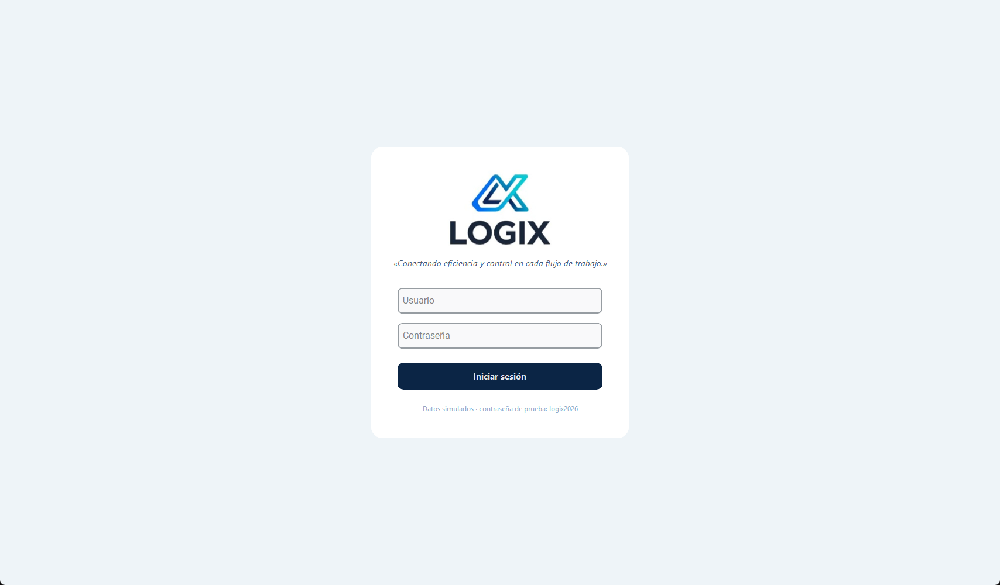

## 02_admin_inicio.png
Inicio (admin): tarjetas por etapa y plazo del material (R3). Adquisiciones ya no usa Logix.

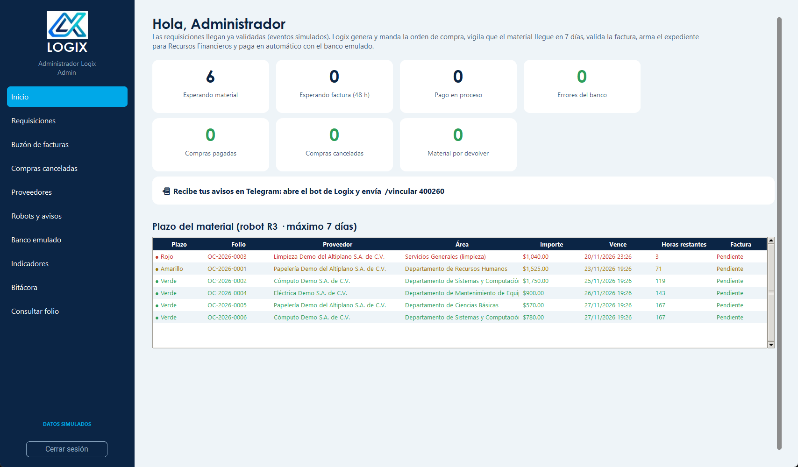

## 03_requisicion_validada_simulada.png
Llegó la requisición REQ-2026-0007 de Recursos Humanos (formato 001-03, partida 21101, validada con 4 firmas). R1 generó sola la OC-2026-0007 para el proveedor fijo de papelería.

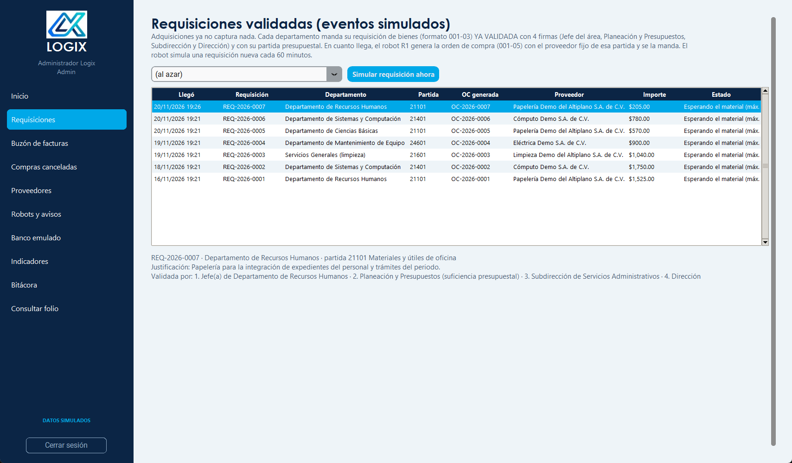

> Logix: Llegó la requisición REQ-2026-0007 (validada). Logix generó la orden de compra OC-2026-0007 y ya se la mandó al proveedor por correo y Telegram.
>

## 04_oc_generada_automatica.png
La OC-2026-0007 salió sola de la requisición: R1 generó el PDF con QR y lo mandó al proveedor.

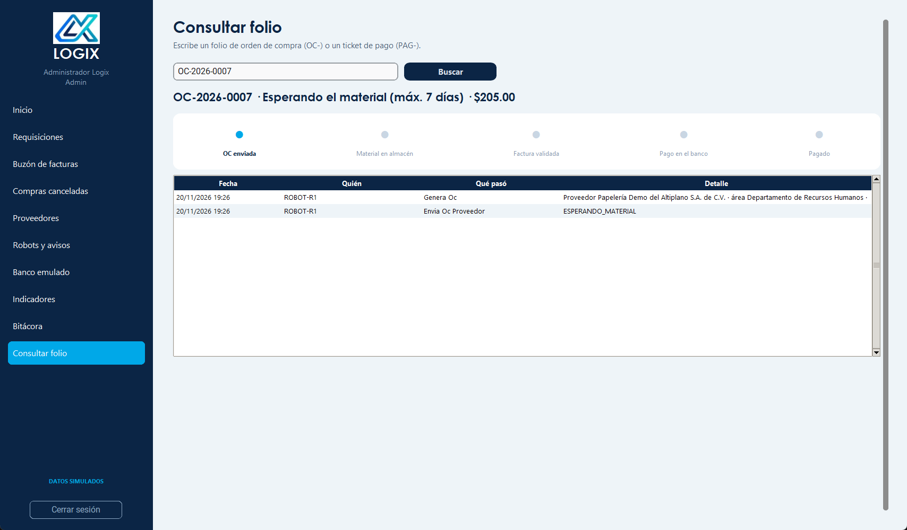

## 05_almacen_que_se_acepto.png
Jefe de Almacén: semáforo del plazo de 7 días y, al seleccionar una orden, exactamente qué se aceptó comprar (requisición, artículos, unidades y cantidades) para compararlo con lo que llegó.

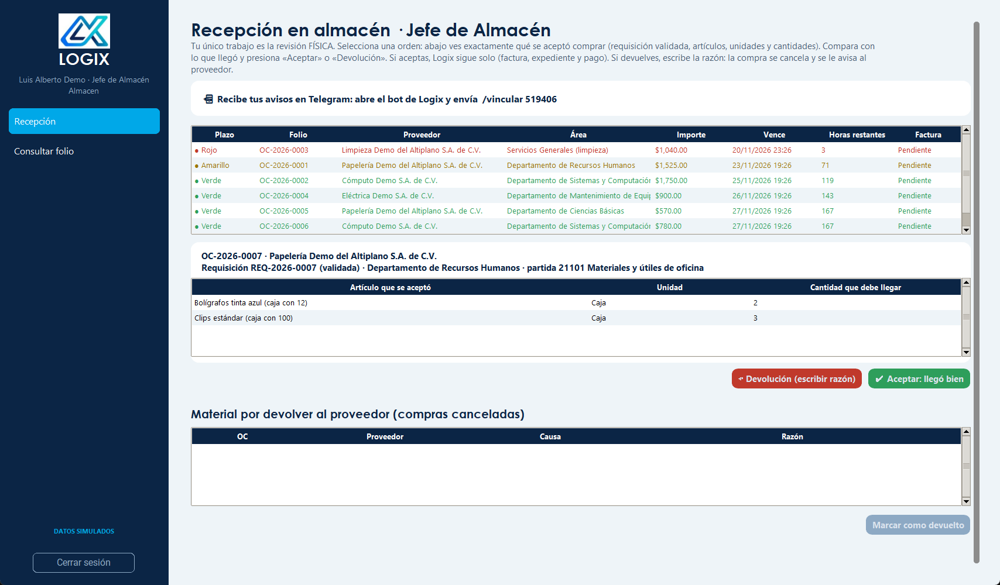

## 06_almacen_devolucion_con_razon.png
Devolución: el jefe escribe la razón; la compra se cancela y se le avisa al proveedor.

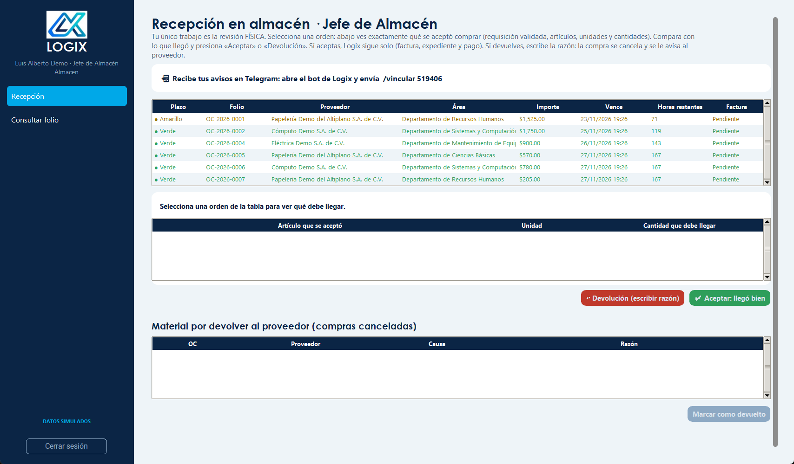

> [Se escribió] Razón de la devolución de OC-2026-0003 (no llegó, llegó dañado, incompleto…). Se le enviará al proveedor: → Llegaron 3 cables, 1 con el conector roto
>
> Logix: Compra cancelada por devolución. Logix le avisó al proveedor por correo y Telegram.
>

## 07_buzon_factura_valida_y_rechazada.png
R2 validó la factura de la OC-2026-0007 y rechazó la de la OC-2026-0004 (importe distinto → cancelada).

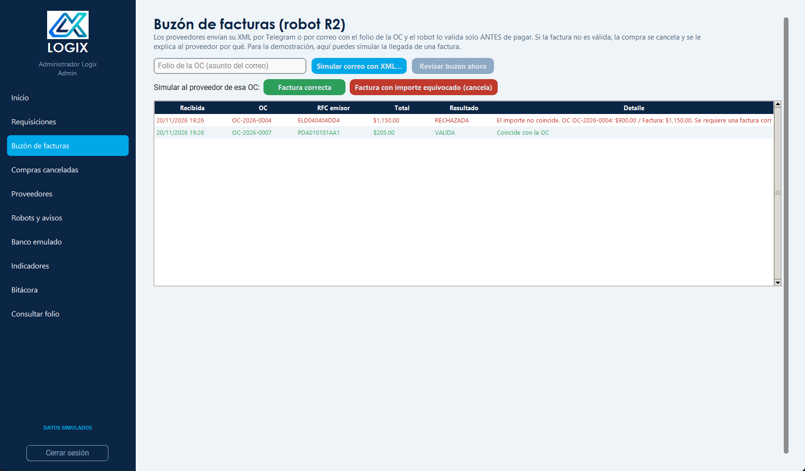

> Robot R2: Resultado: VALIDA
>
> Robot R2: Resultado: RECHAZADA Reglas: IMPORTE_DISTINTO
>

## 08_compras_canceladas_con_razon.png
Compras canceladas con su causa y la razón que se le mandó al proveedor.

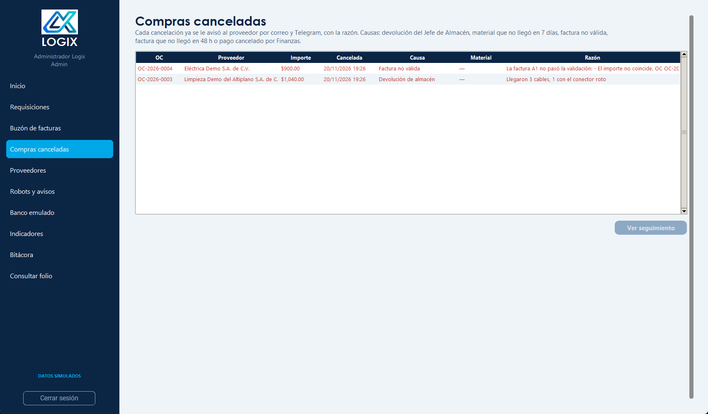

## 09_almacen_acepta_pago_automatico.png
El jefe aceptó el material y la factura ya estaba validada: R4 armó el expediente y R5 pagó en el banco.

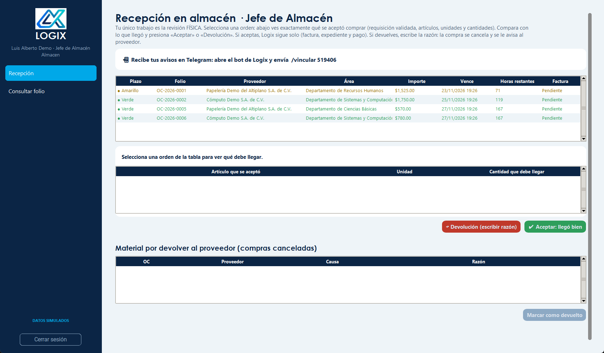

> Logix: Material aceptado (entrada ENT-00001, salida SAL-00001). La factura ya estaba validada: Logix mandó el expediente a Finanzas y el pago sale al banco en unos minutos.
>

## 10_finanzas_sin_fallas.png
Finanzas no tuvo que hacer nada: el pago salió solo. Su pantalla solo muestra fallas (ninguna).

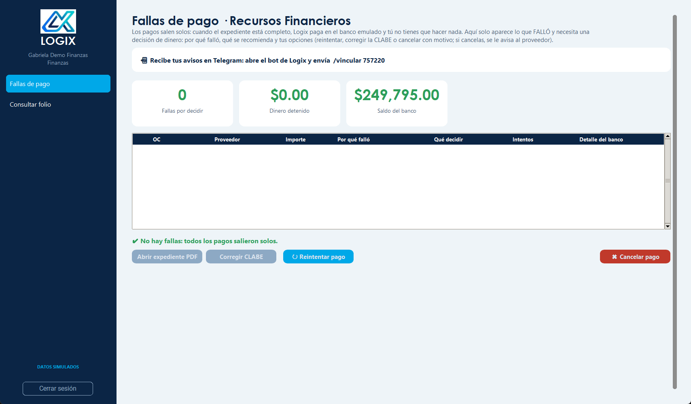

## 11_finanzas_falla_saldo_insuficiente.png
Falla SALDO_INSUFICIENTE: Finanzas ve por qué falló, qué decidir y el dinero detenido (no se reintenta solo).

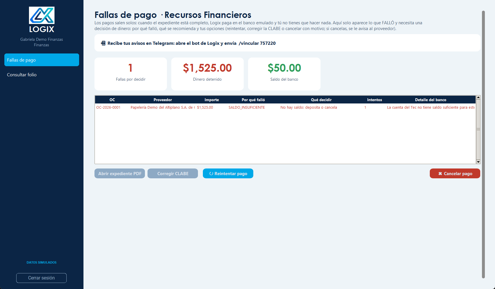

> Logix: Material aceptado (entrada ENT-00002, salida SAL-00002). Logix le pidió la factura al proveedor (tiene 48 horas).
>
> Robot R2: Resultado: VALIDA
>

## 12_banco_emulado.png
Banco emulado: saldo, falla simulada y cada respuesta del banco.

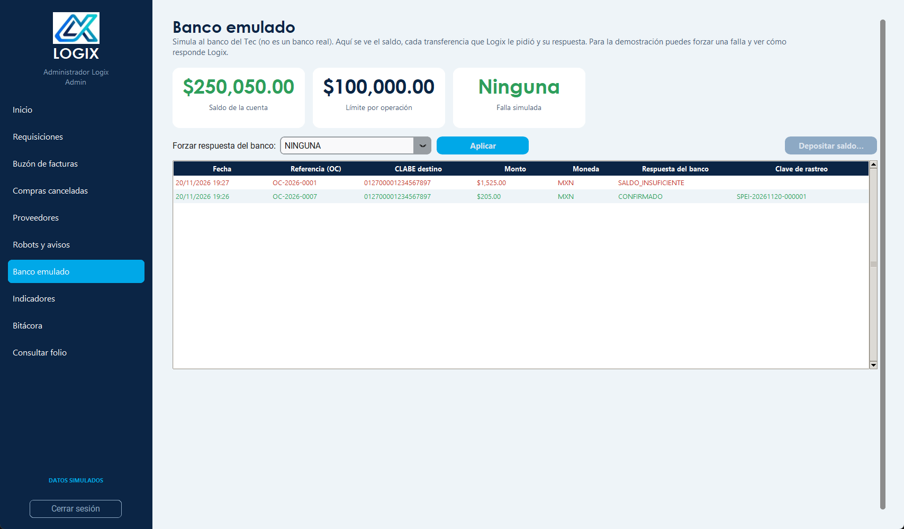

## 13_finanzas_reintento_confirmado.png
Con saldo, Finanzas reintentó y el banco confirmó el pago.

> Banco emulado: ✔ El banco confirmó el pago.
>

## 14_finanzas_error_general_3_intentos.png
ERROR_GENERAL: el robot reintentó solo 3 veces; después pasó a Finanzas.

> Logix: Material aceptado (entrada ENT-00003, salida SAL-00003). Logix le pidió la factura al proveedor (tiene 48 horas).
>
> Robot R2: Resultado: VALIDA
>
> Robots: R0 requisiciones simuladas: 0 R2 facturas: 0 R3 plazos: {'recordatorios': 0, 'avisos_cancelacion': 0, 'cancelaciones': 0} R5 pagos programados: 0 R5 reintentos de pago: 1 R7 mensajes del bot: 0 R6 avisos: {'ENVIADA': 0, 'SIMULADA': 16, 'FALLIDA': 0, 'REINTENTO': 0}
>
> Robots: R0 requisiciones simuladas: 0 R2 facturas: 0 R3 plazos: {'recordatorios': 0, 'avisos_cancelacion': 0, 'cancelaciones': 0} R5 pagos programados: 0 R5 reintentos de pago: 1 R7 mensajes del bot: 0 R6 avisos: {'ENVIADA': 0, 'SIMULADA': 2, 'FALLIDA': 0, 'REINTENTO': 0}
>

## 15_finanzas_cancela_pago.png
Finanzas canceló el pago con motivo: se le avisó al proveedor; el material se devuelve.

> [Se escribió] Motivo de la cancelación de OC-2026-0006 (se le enviará al proveedor): → El banco no responde desde hace dos días; se recompra con otro trámite
>
> Logix: Compra cancelada. Logix le avisó al proveedor.
>

## 16_seguimiento_pagada.png
Seguimiento de la OC-2026-0007: Pagada, con su línea de tiempo.

## 17_seguimiento_cancelada.png
Seguimiento de una compra cancelada por factura no válida.

## 18_almacen_material_por_devolver.png
Material por devolver al proveedor (compras canceladas).

## 19_avisos_correo_y_telegram.png
Cola de avisos por correo y Telegram (modo simulado).

## 20_indicadores.png
Indicadores calculados solos desde la base y la bitácora.

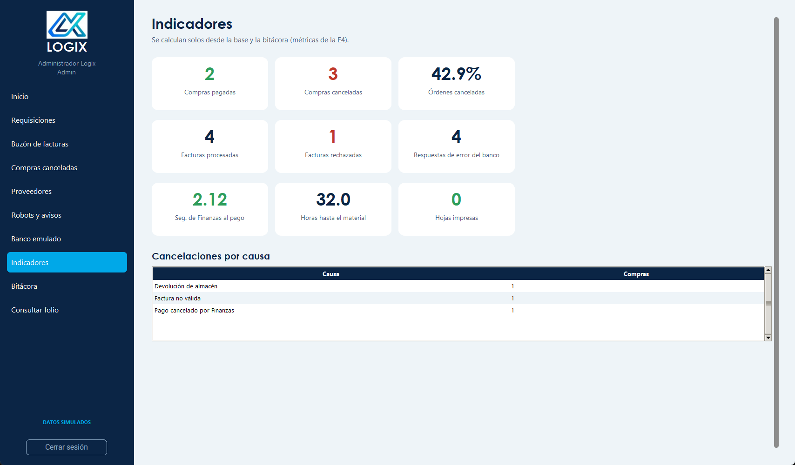

## 21_bitacora.png
Bitácora de auditoría (no se puede modificar ni borrar).

## 22_pdf_orden_de_compra.png
PDF de la orden de compra (001-05) con QR que recibe el proveedor.

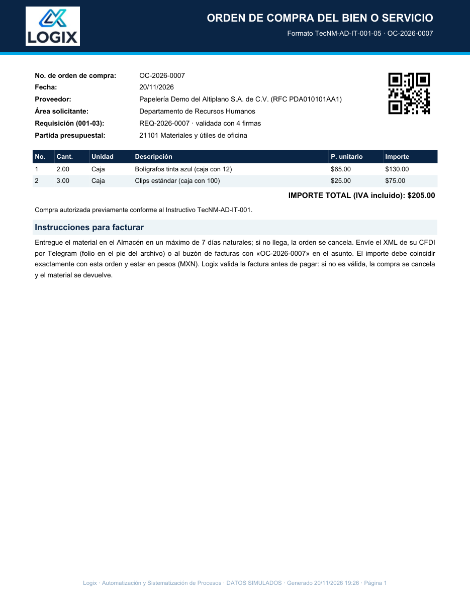

## 23_pdf_expediente_finanzas.png
PDF del expediente para Recursos Financieros (memorándum + revisión automática).

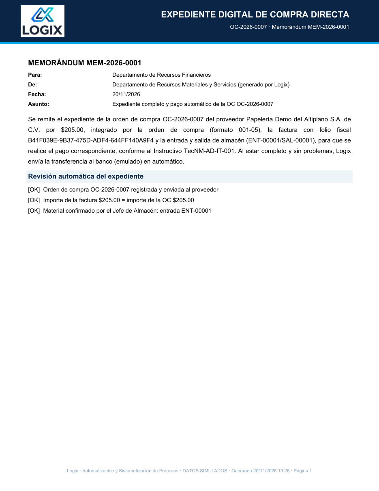

